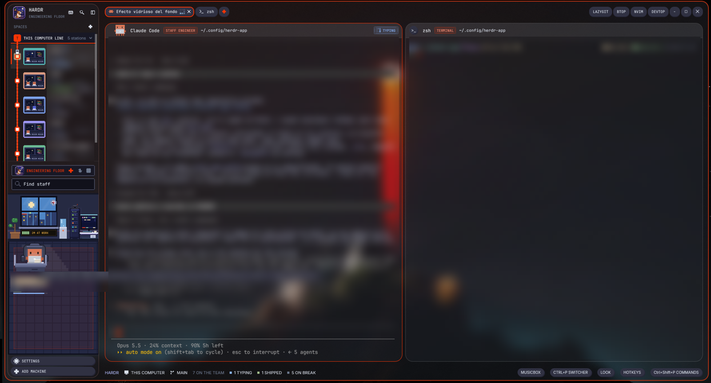

# Hardr

Mi configuración de [Herdr](https://github.com/herdrdev/herdr-app), la app de escritorio para terminales y agentes de código. La pieza principal es **Hardr**, un layout de vidrio que toma sus colores de KDE Plasma y Kvantum, con una oficina pixel art donde cada agente (Claude Code, Codex, OpenCode…) tiene su escritorio.



Hardr nació como una versión modificada de [Pixel HQ](https://github.com/bnhan2710/pixel-hq) y hoy es un layout aparte, con sus propios mods (`hardr-*`) y sin el actualizador de Pixel HQ.

## Qué tiene

- **Vidrio sincronizado con KDE.** `kde-sync.py` lee el color de acento de Plasma, el tinte del tema Kvantum y el radio de las esquinas de KWin, y con eso escribe `layouts/hardr.json` y los temas `hardr` / `hardr-light`. Cuando Kvantum es claro, Hardr se vuelve claro también.
- **Popover LOOK** en la barra de abajo: modo oscuro, claro o del sistema, transparencia de la ventana (0–95 %) y desenfoque. El desenfoque mueve la intensidad del efecto Blur de KWin, que es global: cambia todas las ventanas desenfocadas, no solo Herdr.
- **Botones de programas** junto a las pestañas: LAZYGIT, BTOP, NVIM y DEVTOP abren el programa en una ventana flotante con el mismo vidrio que los paneles. NVIM abre en el repo del panel activo y sigue vivo al ocultarlo. También son comandos (`hardr-tabs.open-btop`, `open-nvim`, `open-devtop`) para asignarles tecla en `keys.json`. Para agregar otro programa basta una línea en `FLOATS` de `mods/hardr-tabs/main.js`.
- **La oficina** de Pixel HQ (`hardr-agents`): un escritorio por agente con su estado (trabajando, bloqueado, terminado, en pausa), barra de contexto y mascotas.
- **MusicBox**, selector de pisos (`ctrl+p`), atajos y notificaciones en el mismo estilo.

## Requisitos

- Herdr app 0.1.18 o más nueva, en Linux.
- KDE Plasma 6 en Wayland, con Kvantum. Sin KDE el layout funciona igual, pero los colores no se sincronizan solos.
- `python3` para `kde-sync.py`.
- `kwriteconfig6` y `busctl`, para el deslizador de desenfoque.
- ImageMagick (`magick`), para el fondo desenfocado de las ventanas flotantes. Sin él, las flotantes usan un tinte casi sólido.
- `lazygit`, `btop` y `nvim` para sus botones. DEVTOP abre `~/devstack/bin/devtop`, una herramienta mía: cambia o quita esa línea en `FLOATS`.

**Sobre el desenfoque en Wayland:** con KWin 6.8, Herdr 0.1.18 no logra pedir el desenfoque detrás de la ventana porque KWin solo ofrece el protocolo `ext-background-effect-v1`. El arreglo está propuesto en [herdrdev/herdr-app#1503](https://github.com/herdrdev/herdr-app/pull/1503). Mientras no entre en una versión, el vidrio se ve transparente pero sin desenfoque, salvo que compiles Herdr con ese cambio.

## Instalación

Esta carpeta es un `~/.config/herdr-app` completo, con mis atajos y otros layouts. Para usar solo Hardr en tu propia configuración, copia:

```sh
git clone https://github.com/armany-ai/herdr-app-config.git /tmp/hardr
cd /tmp/hardr
cp -r mods/hardr-* ~/.config/herdr-app/mods/
cp layouts/hardr.json layouts/hardr.png ~/.config/herdr-app/layouts/
cp themes/hardr.json themes/hardr-light.json ~/.config/herdr-app/themes/
cp kde-sync.py hardr-look.json ~/.config/herdr-app/
```

Luego cambia de layout con `ctrl+shift+l` o con:

```sh
herdr-app do layout.switch --name hardr
```

Para que los colores sigan a KDE cuando cambias el acento, el tema de Kvantum o las esquinas:

```sh
cp systemd/herdr-kde-sync.* ~/.config/systemd/user/
systemctl --user daemon-reload
systemctl --user enable --now herdr-kde-sync.path
python3 ~/.config/herdr-app/kde-sync.py   # una vez, para empezar
```

## Archivos

| Archivo | Qué es |
|---|---|
| `layouts/hardr.json` | El layout. Lo reescribe `kde-sync.py`: edita colores y fondos ahí, no a mano. |
| `themes/hardr.json`, `themes/hardr-light.json` | Los temas de terminal, oscuro y claro. |
| `hardr-look.json` | Lo que eliges en el popover LOOK. |
| `kde-sync.py` | Sincroniza KDE / Kvantum / KWin con Hardr. |
| `mods/hardr-*` | Los mods de Hardr: barra de pestañas, paneles, barra de estado, oficina, LOOK, flotantes… |
| `systemd/` | Las unidades que corren `kde-sync.py` cuando cambia la configuración de KDE. |

El resto (otros layouts, mods `company-*` de Pixel HQ, mods `neon-*`, `p5-*`, etc.) son layouts que he probado y que siguen en esta carpeta.

## Créditos y licencias

- **Pixel HQ**, de [bnhan2710](https://github.com/bnhan2710/pixel-hq), bajo licencia MIT. Hardr parte de su código y sus dibujos; su licencia y sus avisos están en [`LICENSES/`](LICENSES/). Los mods `company-*` y el layout `pixel-hq` son Pixel HQ v1.8.8 sin modificar.
- **Herdr** y sus mods y layouts incluidos (`main`, `terminals`, `win98`, `agents`, `spaces`, `tabs`, `pane`, …) son de [herdrdev/herdr-app](https://github.com/herdrdev/herdr-app), bajo Apache-2.0.
- Los demás layouts y mods de terceros (por ejemplo `brutal-metrics`, `neon-borough`, `persona5`, `islands`) vienen de [herdr.dev/layouts](https://herdr.dev/layouts) y [herdr.dev/mods](https://herdr.dev/mods) y pertenecen a sus autores.

Claude, Codex, OpenCode, Antigravity, Herdr y KDE son marcas de sus respectivos dueños; este proyecto no está afiliado a ninguno de ellos.
